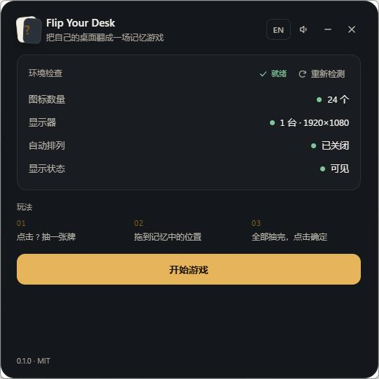
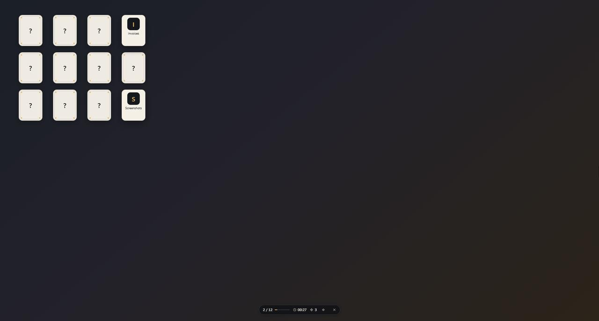
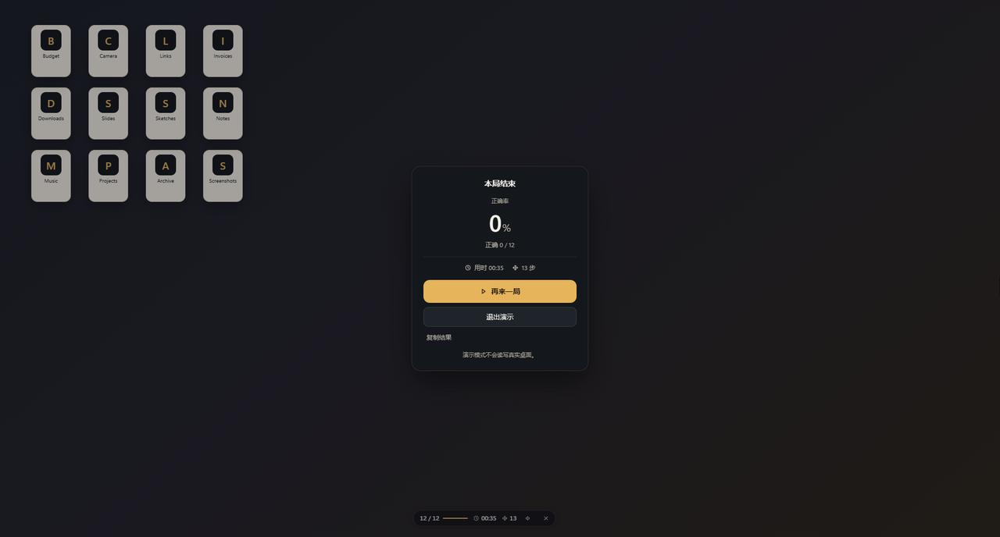
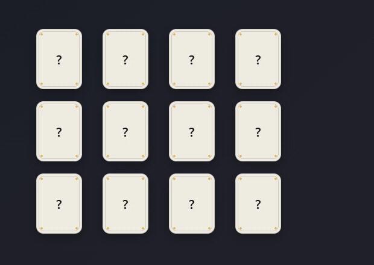

# Flip Your Desk

Flip every desktop icon face down, draw the real icons back at random, and put each one where you remember it.

[中文](README.md) · License: MIT

## What it does

- Remembers where every desktop icon sits, then turns each position into a face-down `?` card
- Click any empty slot to draw an icon at random; the card flips to the real icon and its label
- Drag icons to swap them, or drop one on an untouched slot to move it
- When every card is drawn, hit Confirm to see your accuracy, time and move count — **numbers only, no hints about which ones were wrong**
- Save the new arrangement (your desktop icons actually move) or restore the original in one click

## Screenshots

| Launcher | Board | Result |
| --- | --- | --- |
|  |  |  |



## Install

Grab a build from [Releases](https://github.com/1yang2471/flip-your-desk/releases):

- `Flip.Your.Desk_0.3.0_x64-setup.exe`: NSIS installer for the current user

The installed program `flip-your-desk.exe` requires the Microsoft Edge WebView2 runtime (ships with Windows 11).

## How to play

1. Open the app and check that the environment panel says Ready
2. Hit Start; the real layout is shown for 3–6 seconds (a shrinking gold ring sits above the HUD; click it to skip), then every icon becomes a `?`
   - Or hit **Timed challenge**: the limit scales with icon count (30s + 5s per icon — 24 icons = 2:30), the HUD counts down, and the round settles automatically when time runs out
   - Time and the timed challenge start only after the cards flip down; the study phase never counts toward your score
3. Click a slot to draw an icon, drag icons to where you remember them
4. Once every card is drawn, hit Confirm
5. Pick Play again, Save new layout or Restore original

### Two prerequisites

- **Auto arrange icons must be off**: right-click the desktop → View → clear Auto arrange icons. While it is on, Explorer ignores any position we write.
- **Desktop icons must be visible**: right-click the desktop → View → tick Show desktop icons.

The app detects both states and tells you how to fix them; it never changes your system settings for you.

## Controls

Mouse only: left-click a slot to draw a card, drag icons to swap positions. Esc opens or closes the exit confirmation dialog (also while a card is selected; the selection is kept); click a selected card again to cancel it.

## Privacy

Fully offline: no network calls, no telemetry, no writes outside its own app data folder. Before saving a layout it leaves an `original-layout.json` backup so you can restore by hand.

## How it works

- Icon positions and labels are read from Explorer's desktop ListView (`LVM_GETITEMPOSITION` / `LVM_GETITEMTEXTW`); positions are written back with `LVM_SETITEMPOSITION32`
- Card faces are cropped from the real desktop pixels (`PrintWindow` on the desktop view; the icons are hidden briefly to capture a clean wallpaper, then restored), so thumbnails and shortcut arrows stay authentic
- Every card back switches between light and dark based on the wallpaper brightness behind it
- Writes are matched by icon name (icons added, renamed or moved mid-round never get mixed up); after writing, every position is read back and double-checked, and failures roll back to the in-memory original layout. Before saving, the original layout is written to `original-layout.json` for manual recovery

## Build from source

You need Node.js 20+, stable Rust, the Microsoft C++ Build Tools (with the Windows SDK) and the WebView2 runtime.

```bash
npm install
npm run tauri dev      # development run (starts a local Vite server on 127.0.0.1:1420)
npm run tauri build    # installers land in src-tauri/target/release/bundle
npm run exe            # one-shot release exe (= run-tauri-build.cmd: loads MSVC env + frontend build + tauri build)
```

> **Do not ship a `cargo build --release` binary.** It compiles the Rust part only and
> never embeds the frontend `dist/`, so the app falls back to the dev URL
> `127.0.0.1:1420` and shows "This site can't be reached". A real release embeds the
> frontend assets (`assets/index-*.css/js`) and opens no ports at runtime.
> `scripts/run-tauri-build.cmd` loads the MSVC environment and runs the correct build.

Type-check the frontend with `npm run check`; run the backend unit tests with
`cargo test --manifest-path src-tauri/Cargo.toml`; run the UI regression suite
(face geometry, i18n, motion, audio) with `npm test` after `npm run build`.

## Known limitations

- Windows 10/11 only for now (macOS and Linux are planned; the code is already split into platform adapters)
- Measured on a simulated desktop with 120 icons: 193fps while dragging, ~7ms flip latency, 1.9MB JS heap — performance is not a bottleneck; start-up cost grows with icon count (mitigated by parallel capture), and very dense boards remain playable
- Multi-monitor code paths exist (one window per display + per-monitor scaling), but mixed-DPI setups are not verified on real hardware yet
- If you use desktop organizers like Fences, disable their layout lock first (the launcher detects and warns about them)

## License

[MIT](LICENSE)
