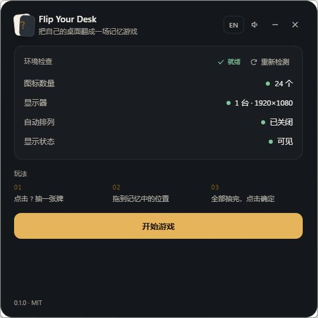
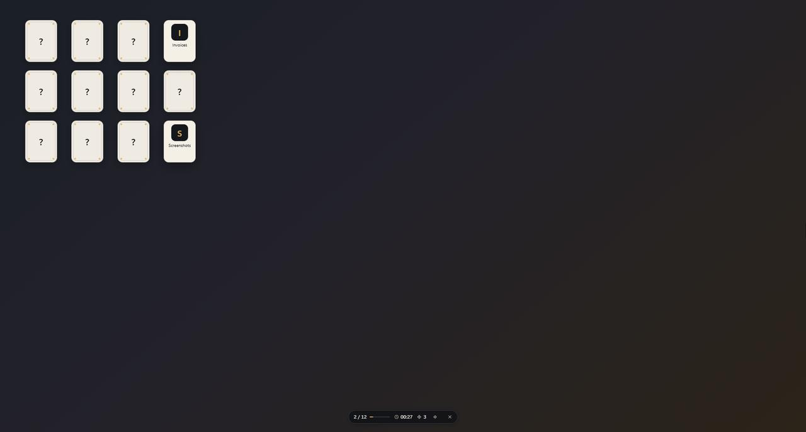
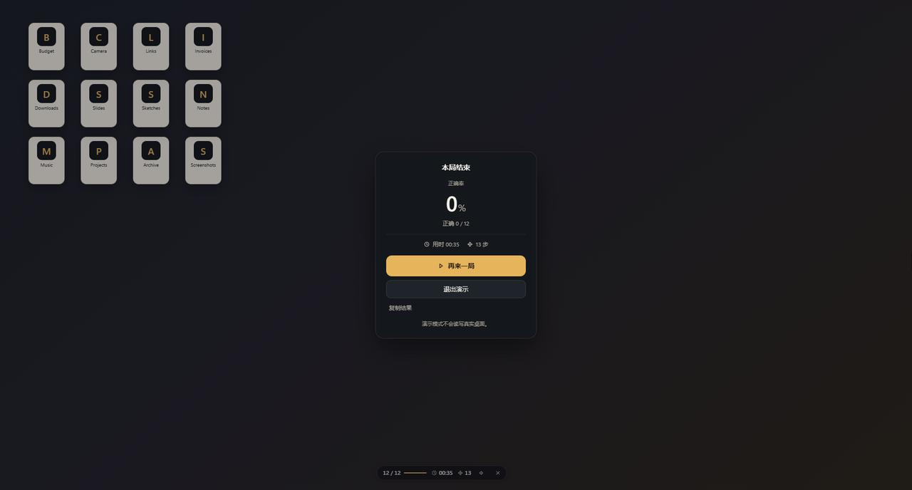
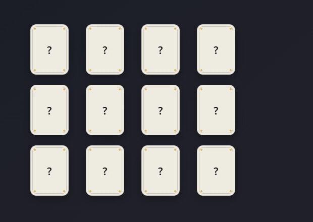

# Flip Your Desk

把桌面图标全部翻面，从牌堆里随机抽出图标，再凭记忆放回原来的位置。

[English](README.en.md) · 许可证：MIT

## 它做什么

- 开局前保存桌面图标的位置，每个图标原位变成一张统一的“?”卡背
- 点击任意卡位，从剩余图标中随机抽出一张，翻牌显示真实图标与名称
- 拖动图标换位；拖到尚未翻开的位置，则该位置显示图标、原位置重新盖上“?”
- 全部抽完后点“确定”，显示正确率、用时与步数——**只给数字，不告诉你错在哪**
- 可以按新布局保存（真实桌面图标随之移动），也可以一键回到原布局

## 截图

| 启动窗 | 牌桌 | 结算 |
| --- | --- | --- |
|  |  |  |



## 安装

从 [Releases](https://github.com/1yang2471/flip-your-desk/releases) 下载：

- `Flip.Your.Desk_0.2.0_x64-setup.exe`：安装版（NSIS，为当前用户安装）

安装后的主程序 `flip-your-desk.exe` 需要 Microsoft Edge WebView2 运行时（Windows 11 自带）。

## 使用

1. 打开应用，先看“环境检查”是否就绪
2. 点“开始游戏”，桌面被覆盖，图标全部翻成“?”
   - 也可以点**“限时挑战”**：时长按图标数算（30 秒 + 每个图标 5 秒，24 个图标 = 2 分 30 秒），HUD 显示剩余时间，到点自动结算
3. 点击卡位抽牌，拖动图标到你记忆中的位置
4. 全部抽完后点“确定”看结果
5. 选择“再来一局”“保存新布局”或“回到原布局”

### 开始前的两个前提

- 桌面的 **“自动排列图标”需要关闭**：右键桌面 → 查看 → 取消勾选“自动排列图标”。开着时 Explorer 会忽略任何位置写入。
- **桌面图标需要可见**：右键桌面 → 查看 → 勾选“显示桌面图标”。

应用检测到这两种状态时会在启动窗里给出对应提示，不会替你改系统设置。

## 操作

纯鼠标操作：左键点击卡位抽牌，拖动图标换位。Esc 仅打开退出确认弹窗，无其他键盘操作。

## 隐私

完全离线运行：不联网、不收集任何数据、不写入除自身设置目录以外的位置。保存布局前会在应用数据目录留下一份 `original-layout.json` 备份，便于人工恢复。

## 工作原理

- 桌面图标的位置与名称通过 Explorer 的桌面 ListView 读取（`LVM_GETITEMPOSITION` / `LVM_GETITEMTEXTW`），位置用 `LVM_SETITEMPOSITION32` 写回
- 卡面图标由桌面画面像素裁出（`PrintWindow` 抓取桌面视图，短暂隐藏桌面图标取得干净壁纸，再恢复），因此包含真实缩略图与快捷方式箭头
- 每张卡背的深/浅由该位置壁纸亮度决定，保证在任意壁纸上都清晰
- 写回以图标名为身份定位（玩到一半图标被增删/改名/移动都不会写错对象），写入后逐项读回坐标与名字双重校验，失败则按内存中的原布局回滚；保存前原布局会落盘 `original-layout.json` 备份，供人工恢复

## 从源码构建

需要 Node.js 20+、Rust stable、Microsoft C++ Build Tools（含 Windows SDK）、WebView2 运行时。

```bash
npm install
npm run tauri dev      # 开发运行（会启动本地 Vite 服务 127.0.0.1:1420）
npm run tauri build    # 生成安装包（输出在 src-tauri/target/release/bundle）
npm run exe            # 一键重编正式 exe（=run-tauri-build.cmd：加载 MSVC 环境 + 前端构建 + tauri build）
```

> **不要用 `cargo build --release` 交付。** 它只编 Rust 二进制，不会把前端 `dist/`
> 嵌进 exe，跑起来会回退去找开发地址 `127.0.0.1:1420` 并显示「无法访问此页面」。
> 正式包的判定标准：exe 内嵌前端的资源文件名（`assets/index-*.css/js`），
> 启动后不监听任何端口。本仓库的 `scripts/run-tauri-build.cmd` 会自动加载 MSVC
> 环境并执行正确的构建流程。

前端类型检查：`npm run check`；后端单元测试：`cargo test --manifest-path src-tauri/Cargo.toml`；
卡面/双语/动效的界面回归测试：`npm test`（需先 `npm run build`）。

## 已知限制

- 仅支持 Windows 10/11（macOS / Linux 计划中，代码已按平台适配层拆分）
- 实测 120 图标模拟桌面：拖拽 193fps、翻牌延迟 ~7ms、JS 堆 1.9MB，性能不是瓶颈；
  开局耗时随图标数线性增长（开局裁剪已并行化缓解），几百图标的牌桌依然可用
- 多显示器代码路径已实现（每屏一窗 + per-monitor 缩放），但混合 DPI 场景未经实机验证
- 若使用 Fences 等桌面整理工具，建议先关闭其布局锁定（启动窗会自动检测并提示）

## 许可证

[MIT](LICENSE)
